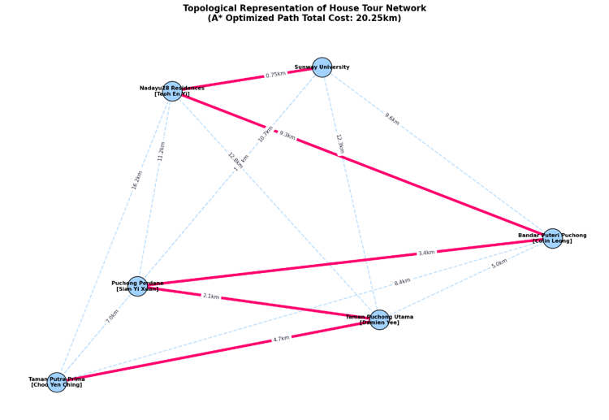
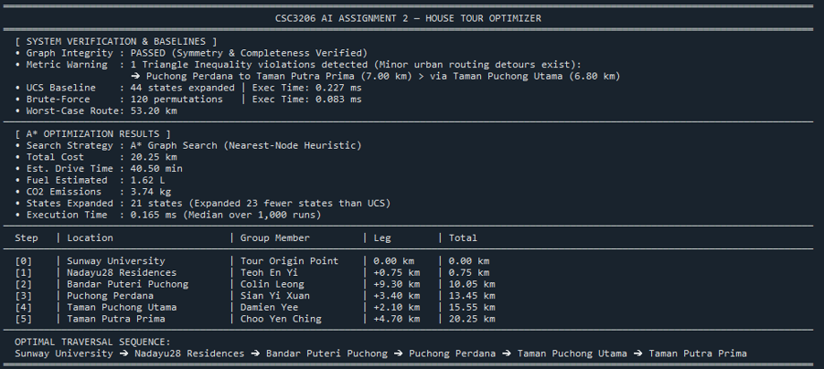

<div align="center">

<sub>CSC3206 · ARTIFICIAL INTELLIGENCE · ASSIGNMENT 2</sub>

# House Tour Optimizer

### Five destinations. One starting point. A smarter route.

A Python search project that explores how to visit every destination while minimizing total travel distance.

**A* Search · Uniform Cost Search · Brute Force · NetworkX · Matplotlib**

[View the route](#the-route-at-a-glance) · [Explore the algorithms](#how-the-search-works) · [Run the project](#quick-start)

</div>

---

## The idea

Planning a tour becomes more interesting when the order of visits changes the total distance. This project models a journey starting at **Sunway University** and visiting five destinations in the surrounding area.

The program uses **A* graph search** to find a minimum-distance traversal of the supplied network. It also runs **Uniform Cost Search (UCS)** and evaluates all **120 visit-once destination orderings** as comparison baselines.

The journey ends when every location has been visited. Returning to the university is not required.

## The route at a glance



*The included diagram represents the supplied weighted network. Highlighted edges show the computed tour; it is a network visualization, not turn-by-turn road navigation.*

### Terminal results



*Captured execution output supplied with the project: A* expands 21 states, compared with 44 for UCS. Execution times reflect this particular run and vary by environment.*

### Sample results

| Route distance | Estimated drive time | Estimated fuel | Estimated CO₂ |
| :---: | :---: | :---: | :---: |
| **20.25 km** | **40.50 min** | **1.62 L** | **3.74 kg** |

These values appear in the supplied execution screenshot and the original project README; they have not been independently reproduced for this documentation update. Travel and environmental figures are calculated from fixed assumptions, not live measurements.

The reported route is:

```text
Sunway University
       ↓ 0.75 km
Nadayu28 Residences
       ↓ 9.30 km
Bandar Puteri Puchong
       ↓ 3.40 km
Puchong Perdana
       ↓ 2.10 km
Taman Puchong Utama
       ↓ 4.70 km
Taman Putra Prima
```

## What the project demonstrates

| Capability | Implementation |
| --- | --- |
| Weighted graph modelling | A symmetric network of locations and distances in kilometres |
| Informed search | A* with a nearest-unvisited-node heuristic |
| Baseline comparison | UCS and exhaustive visit-once route enumeration |
| Graph validation | Completeness, symmetry, and non-negative edge checks |
| Metric inspection | Reports triangle-inequality violations |
| Performance measurement | Median execution time over 1,000 runs per algorithm |
| Route reporting | Step-by-step distances and cumulative totals |
| Visualization | A labelled network diagram saved as `route_map.png` |
| Impact estimates | Travel time, fuel consumption, and CO₂ calculations |

## How the search works

### 1. Model the network

Distances are defined in `raw_edges`. The program builds the reverse edges automatically, producing an undirected graph containing six locations: one starting point and five destinations.

Each search state consists of:

```text
(current location, set of visited locations)
```

Tracking both components distinguishes arriving at the same location with different progress through the tour.

### 2. Rank possible moves with A*

A* orders its priority queue using:

```text
f(state) = g(state) + h(state)
```

- **g:** Distance already travelled.
- **h:** Distance from the current location to the nearest unvisited location.
- **f:** The sum used to prioritize exploration.

When all locations have been visited, the heuristic becomes zero. The implementation keeps the best known cost for each state, skips stale queue entries, and permits improved states to be processed again.

### 3. Compare with two baselines

| Algorithm | Strategy | Comparison value |
| --- | --- | --- |
| **A*** | Prioritizes distance travelled plus the heuristic | Demonstrates informed search |
| **UCS** | Uses the same search with `h = 0` | Provides an uninformed search baseline |
| **Brute force** | Enumerates all `5! = 120` destination orderings | Finds the best and worst visit-once routes |

The program checks that the A* cost matches the best brute-force cost within a tolerance of `1e-9` for the supplied instance.

<details>
<summary><strong>Important distinction: traversal versus visit-once routes</strong></summary>

The A* and UCS implementations allow moves to previously visited locations. Their goal is to visit every location at least once. Brute force instead visits each destination exactly once.

For the supplied instance, the original output reports matching optimal costs. In general, these are different search spaces. Because the supplied distances also contain a triangle-inequality violation, the nearest-unvisited direct-edge distance should not be described as universally admissible for every traversal state: a cheaper route to an unvisited destination may pass through another location.

The built-in cost comparison checks agreement on this dataset; it is not a general proof of optimality for arbitrary modified graphs. A stricter visit-once formulation or a shortest-path-based lower bound would make the assumptions easier to establish.

</details>

## Benchmark snapshot

The original submission reports:

| Measure | A* | UCS | Brute force |
| --- | ---: | ---: | ---: |
| Expanded search states | 21 | 44 | Not applicable |
| Complete orderings evaluated | Not applicable | Not applicable | 120 |

In that sample, A* expands **23 fewer states** than UCS. State expansions and complete route permutations are different units of work and should not be compared directly.

The script measures each algorithm over **1,000 runs** and reports the median duration in milliseconds. Timing depends on hardware, Python, and the execution environment; fewer expanded states do not automatically imply a lower measured runtime.

## Quick start

### Requirements

- Python 3.9 or newer, as specified in the original project.
- Matplotlib and NetworkX.

Install versions of these libraries compatible with your Python version.

### Install dependencies

Open a terminal in the extracted project folder:

```bash
python -m pip install matplotlib networkx
```

### Run the optimizer

```bash
python HouseTourOptimizer_A-star-Search.py
```

On systems where Python is invoked as `python3`, use that command instead.

### Expected output

The terminal displays:

1. Graph validation results and triangle-inequality warnings.
2. UCS and brute-force comparison statistics.
3. A* route distance, expanded states, and timing.
4. Estimated travel time, fuel consumption, and CO₂ emissions.
5. A table showing each route leg and cumulative distance.
6. The final traversal sequence.

The program also saves **`route_map.png` in the current working directory**, replacing a file with that name if one already exists. Run from the project folder to keep the output beside this README.

When the script selects Matplotlib's `Agg` backend for a headless or redirected-output environment, the image is saved without opening an interactive plot window.

## Project structure

```text
house-tour-optimizer/
├── README.md
├── HouseTourOptimizer_A-star-Search.py
├── route_map.png                 # Generated when the script runs
└── images/
    ├── optimized-route.png        # Route screenshot used in this README
    └── terminal-results.png       # Captured execution output
```

The supplied archive also contains `.spyproject/`, which stores local Spyder configuration and is not required to run the optimizer.

## Travel and environmental assumptions

| Constant | Value | Purpose |
| --- | ---: | --- |
| Average speed | 30 km/h | Estimate driving time |
| Fuel consumption | 0.08 L/km | Estimate fuel usage |
| Emissions factor | 2.31 kg CO₂/L | Estimate fuel-related CO₂ |

```text
Driving time (minutes) = distance ÷ average speed × 60
Fuel (litres)          = distance × fuel consumption rate
CO₂ (kg)               = fuel × emissions factor
```

These are illustrative calculations. They do not account for traffic, stops, vehicle differences, or changing road conditions.

## Customize the tour

| Change | Edit in the script |
| --- | --- |
| Locations and distances | `raw_edges` |
| Destination display names | `member_mapping` |
| Plot coordinates | `pos` |
| Starting location | Calls to the search and brute-force functions |
| Travel assumptions | `AVG_SPEED_KMH`, `FUEL_RATE_L_PER_KM`, `CO2_RATE_KG_PER_L` |
| Benchmark repetitions | The three `range(1000)` loops |

Maintain a complete graph with non-negative distances and provide plot coordinates for every location. After changing the data, review the validation output and algorithm agreement.

## Troubleshooting

| Symptom | What to check |
| --- | --- |
| Missing `matplotlib` or `networkx` | Install dependencies with the same Python interpreter used to run the script. |
| Script cannot be found | Open the terminal in the folder containing `HouseTourOptimizer_A-star-Search.py`. |
| No interactive plot appears | Check for the saved PNG; the program may be using the non-interactive backend. |
| PNG is missing | Review terminal errors and check write permission in the working directory. |
| Triangle-inequality warning | Inspect the reported distance pair; the warning identifies a property of the supplied graph. |
| A* and brute-force mismatch | Review the modified graph, heuristic, and differing revisit rules before interpreting the result. |
